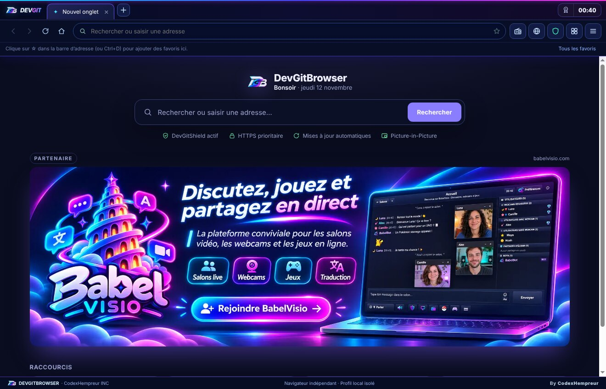
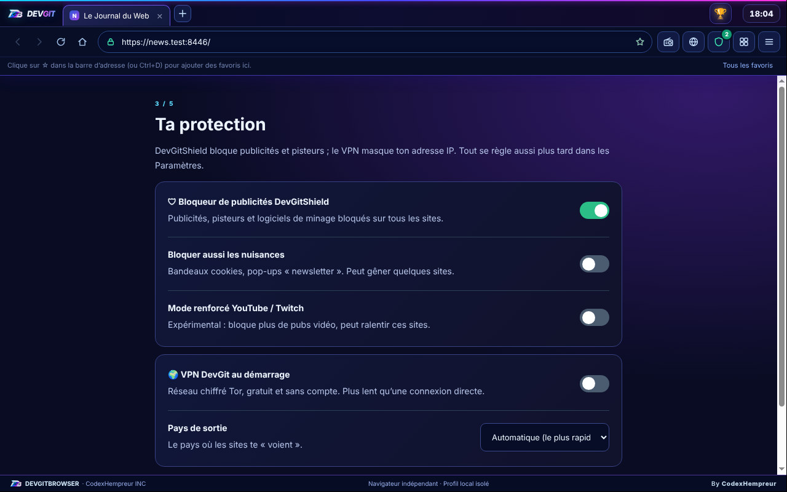
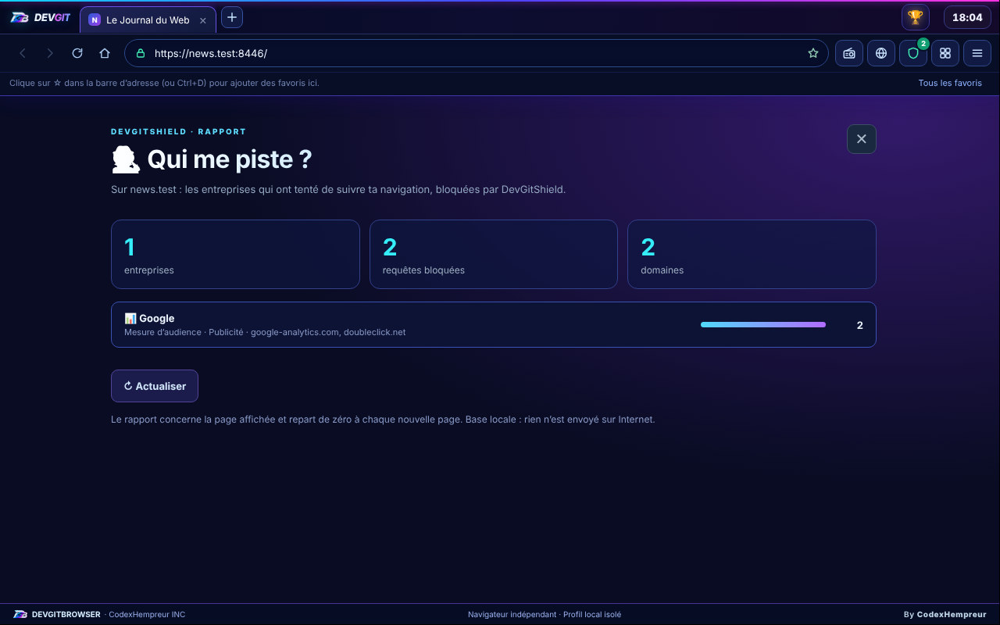
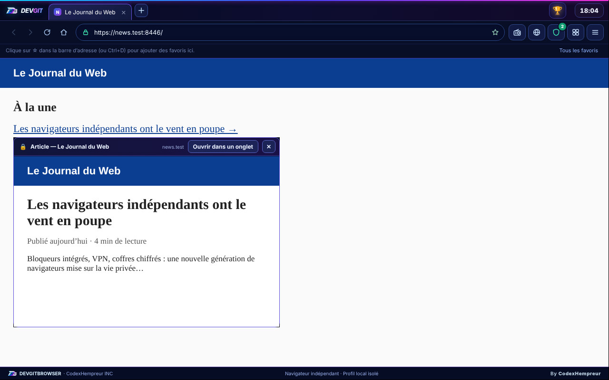
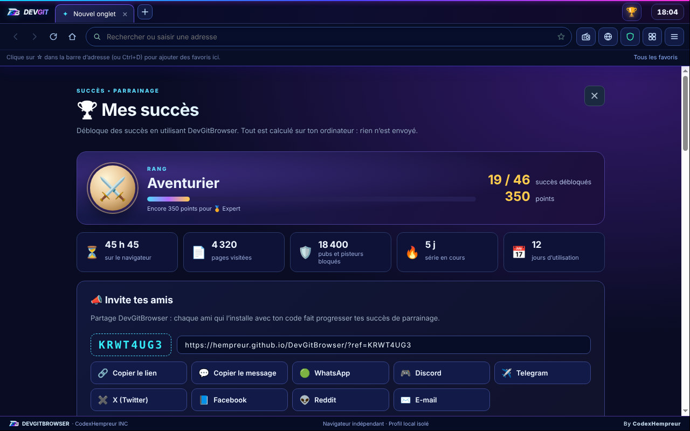

# DevGitBrowser

### Le web, en mode nouvelle génération.

Un navigateur **gratuit**, **rapide** et **respectueux de ta vie privée**, imaginé par **CodexHempreur INC**. 
Bloqueur de publicités, VPN, coffre à mots de passe : tout est déjà inclus, sans abonnement et sans compte.

 

&nbsp;

**[🌐 Site officiel](https://hempreur.github.io/DevGitBrowser/)** · **[📋 Nouveautés Windows](CHANGELOG.md)** · **[📱 Nouveautés Android](android/CHANGELOG.md)**

 

 

## ✨ Pourquoi DevGitBrowser ?

<table>
<tr>
<td width="33%" valign="top">

### 🛡️ Zéro pub, zéro pistage
**DevGitShield** bloque les publicités, les pisteurs et les sites dangereux, dès l'installation. Et « **Qui me piste ?** » te montre qui essayait de te suivre.

</td>
<td width="33%" valign="top">

### 🌍 VPN gratuit
Un clic et ta navigation passe par le réseau **Tor** : les sites ne voient plus ton adresse IP. Gratuit, sans compte, sans limite.

</td>
<td width="33%" valign="top">

### 🔐 Coffre-fort
Tes mots de passe sont **chiffrés sur ton appareil**. Générateur, vérification des fuites et import depuis ton ancien navigateur.

</td>
</tr>
<tr>
<td width="33%" valign="top">

### 📥 On déménage pour toi
Favoris, historique et mots de passe récupérés depuis **Chrome, Edge, Firefox, Brave, Opera**… en quelques clics.

</td>
<td width="33%" valign="top">

### 🎬 Tes séries, sans souci
**Netflix, Disney+, Prime Video** fonctionnent grâce au lecteur protégé intégré.

</td>
<td width="33%" valign="top">

### 🏆 Succès & parrainage
Débloque des succès, grimpe dans les rangs et **invite tes amis** en un clic.

</td>
</tr>
<tr>
<td width="33%" valign="top">

### 🎨 À ton image
Thèmes de couleurs, effets Windows 11, horloge et météo, interface **en français ou en anglais**.

</td>
<td width="33%" valign="top">

### ⚽ MatchPulse
Suis tes matchs en direct et reçois une alerte à chaque but, carton ou pénalty.

</td>
<td width="33%" valign="top">

### 📻 Et plein de bonus
Radios du monde entier, Picture-in-Picture, mode gaming, aperçu des liens, boutique d'extensions…

</td>
</tr>
</table>

## 📸 En images

<table>
<tr>
<td width="50%">
<b>Un assistant de bienvenue</b> Thème, protection et import en 5 étapes.
</td>
<td width="50%">
<b>Qui me piste ?</b> Les pisteurs bloqués, entreprise par entreprise.
</td>
</tr>
<tr>
<td width="50%">
<b>Aperçu des liens</b> Maj + survol pour lire sans changer de page.
</td>
<td width="50%">
<b>Succès et rangs</b> Ta progression et tes invitations.
</td>
</tr>
</table>

## 📱 Aussi sur Android

DevGitBrowser t'accompagne aussi sur ton téléphone (**Android 8 et plus récent**, version Bêta) :
DevGitShield, onglets privés, mode Tor, coffre à mots de passe, MatchPulse, succès et parrainage.

➡️ Télécharge l'application depuis la **[section Android du site](https://hempreur.github.io/DevGitBrowser/#android)**, ouvre le fichier sur ton téléphone et laisse-toi guider. Les mises à jour se font ensuite toutes seules.

## ⬇️ Installer sur Windows

1. Télécharge le fichier **`DevGitBrowser-Setup-….exe`** depuis la [dernière version](https://github.com/hempreur/DevGitBrowser/releases/latest).
2. Lance-le. Si Windows affiche « *Windows a protégé votre ordinateur* », clique sur **Informations complémentaires**, puis sur **Exécuter quand même**. C'est normal pour un logiciel indépendant ([guide illustré](https://hempreur.github.io/DevGitBrowser/#installation)).
3. Choisis ton thème et ta protection, importe tes favoris… c'est prêt !

> 💡 **Windows 10 ou 11 (64 bits)**. Les mises à jour s'installent ensuite toutes seules, et tes onglets sont rouverts.

## 🔒 Ta vie privée d'abord

- 🏠 Historique, favoris, mots de passe et réglages **restent sur ton appareil**.
- 📊 Des statistiques **anonymes** ne sont envoyées **qu'avec ton accord**, et jamais les sites que tu visites.
- 🚫 Pas de compte, pas de publicité, pas de revente de données.

## 💬 Communauté

- 💜 **Discord** : [discord.gg/hmQZuDXBvu](https://discord.gg/hmQZuDXBvu) pour poser tes questions, proposer des idées et suivre les nouveautés.
- 🐞 **Un bug ?** Dans le navigateur : ☰ → À propos → **Signaler un bug**. L'équipe peut ensuite te répondre directement.

 

<b>📜 Crédits</b>

 

DevGitBrowser s'appuie sur de super projets libres : [Chromium](https://www.chromium.org/) via [Electron](https://www.electronjs.org/) et [castLabs](https://github.com/castlabs/electron-releases), [Ghostery adblocker](https://github.com/ghostery/adblocker) (MPL-2.0) avec les listes EasyList, EasyPrivacy, uBlock Origin (GPL-3.0), Peter Lowe et EasyList France, [Tor](https://www.torproject.org/), [radio-browser.info](https://www.radio-browser.info/), [malware-filter](https://gitlab.com/malware-filter), [Open-Meteo](https://open-meteo.com/), [Have I Been Pwned](https://haveibeenpwned.com/Passwords) et [Natural Earth](https://www.naturalearthdata.com/).

 
© 2026 <b>CodexHempreur INC</b> · DevGitBrowser n'est affilié ni à Google, ni à Microsoft, ni au projet Tor.

