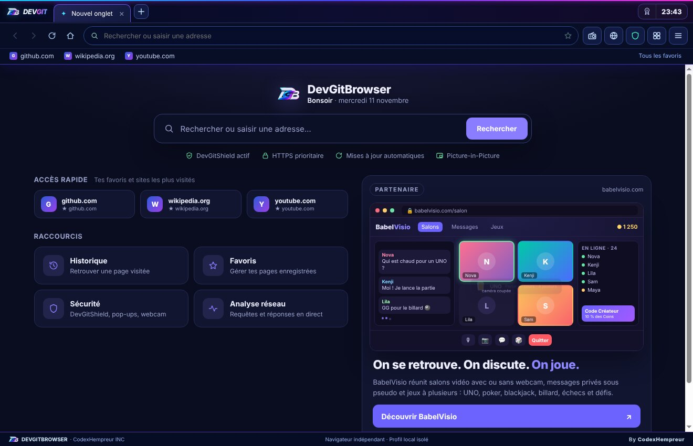
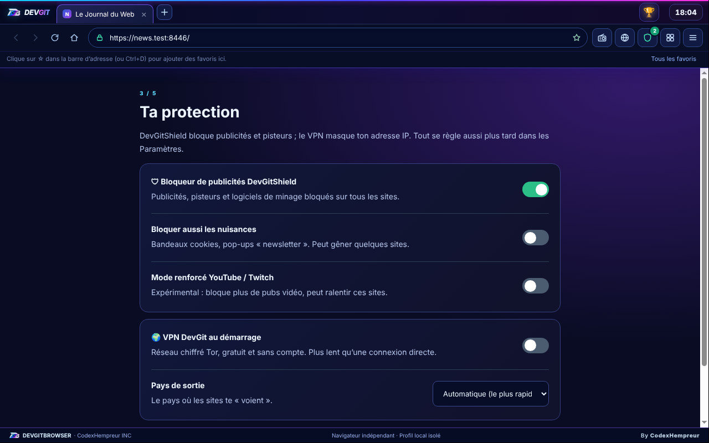
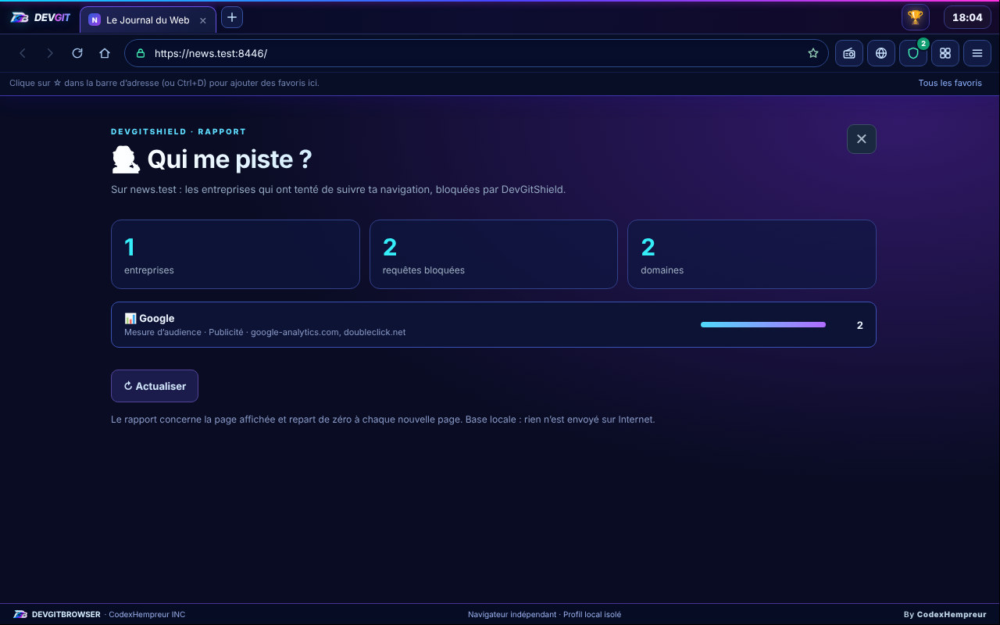
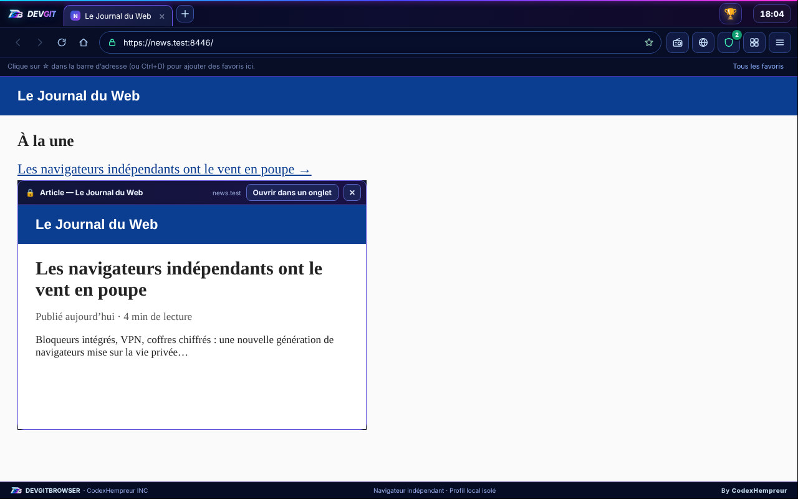
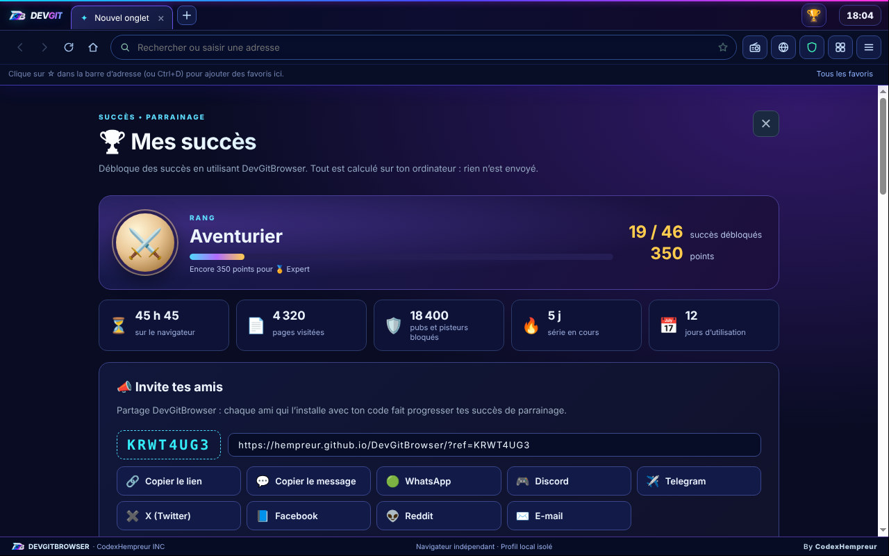
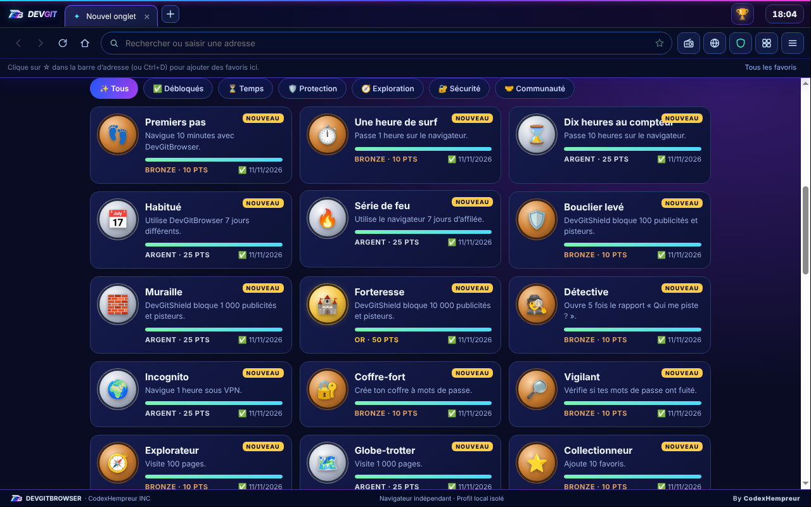

<div align="center">


# DevGitBrowser

**Le web, en mode nouvelle génération.**

Le navigateur Windows tout-en-un de **CodexHempreur INC** : bloqueur de publicités, VPN gratuit, coffre à mots de passe chiffré et outils de développement, dans un seul logiciel gratuit, sans compte ni abonnement.

[](https://github.com/hempreur/DevGitBrowser/releases/latest)
[](https://github.com/hempreur/DevGitBrowser/releases)
[](https://github.com/hempreur/DevGitBrowser/releases/latest)
[](https://discord.gg/hmQZuDXBvu)

### [⬇️ Télécharger pour Windows](https://github.com/hempreur/DevGitBrowser/releases/latest) · [🌐 Site officiel](https://hempreur.github.io/DevGitBrowser/) · [📋 Nouveautés](CHANGELOG.md)



</div>

---

## ✨ Ce qui le rend différent

| Fonction | En bref |
|---|---|
| 🛡️ **DevGitShield** | Bloqueur de publicités et de pisteurs intégré, compatible avec les listes uBlock Origin et EasyList, mises à jour chaque jour. Pause possible site par site. |
| 🕵️ **Qui me piste ?** | Pour chaque page, la liste des entreprises (Google, Meta, Amazon, TikTok, Criteo…) qui ont tenté de suivre ta navigation, avec leur rôle. |
| 🌍 **VPN gratuit** | Réseau chiffré Tor, choix du pays de sortie, connexion au démarrage si tu le souhaites, et **onglets privés sous VPN** (clic droit sur ＋). |
| 🔐 **Coffre à mots de passe** | Chiffré en AES-256 sur ton PC. Générateur, vérification des fuites (Have I Been Pwned, sans jamais envoyer tes mots de passe) et remplissage automatique de tes coordonnées. |
| 📥 **Import en un clic** | Favoris et historique depuis Chrome, Edge, Brave, Opera, Vivaldi et Firefox ; mots de passe via l'export CSV officiel. |
| 👁️ **Aperçu des liens** | Maj + survol d'un lien : la page s'ouvre dans une petite fenêtre, sans quitter la page en cours. |
| 🎬 **Lecteur protégé** | Netflix, Disney+, Prime Video et les autres plateformes s'ouvrent dans un lecteur certifié (Widevine). |
| 🏆 **Succès et parrainage** | 46 succès à débloquer, des rangs, et un lien d'invitation à partager en un clic (WhatsApp, Discord, Telegram, X…). |
| 🎨 **Personnalisable** | 7 thèmes, effet Mica/Acrylic de Windows 11, horloge et météo, interface **en français ou en anglais**. |
| 📻 **Et aussi** | Radios du monde entier, Picture-in-Picture, mode gaming, gestionnaire de tâches, onglets détachables, analyse réseau, statut Discord, boutique d'extensions DevGit Store. |

## 📸 Aperçu

<table>
<tr>
<td width="50%"><br><sub><b>Assistant de bienvenue</b> : thème, moteur de recherche, protection, import et coffre en 5 étapes.</sub></td>
<td width="50%"><br><sub><b>Qui me piste ?</b> : les pisteurs bloqués sur la page, entreprise par entreprise.</sub></td>
</tr>
<tr>
<td width="50%"><br><sub><b>Aperçu des liens</b> : Maj + survol pour lire sans changer de page.</sub></td>
<td width="50%"><br><sub><b>Succès</b> : rang, statistiques et invitations à partager.</sub></td>
</tr>
</table>

<p align="center"><br><sub>Chaque succès a son icône, son palier (bronze, argent, or, platine) et sa progression.</sub></p>

## ⬇️ Installation

1. Télécharge **`DevGitBrowser-Setup-x.y.z.exe`** depuis la [dernière version](https://github.com/hempreur/DevGitBrowser/releases/latest).
2. Lance le fichier. Windows peut afficher « **Windows a protégé votre ordinateur** » (éditeur inconnu, l'installateur n'étant pas encore signé) : clique sur **Informations complémentaires**, puis **Exécuter quand même**. Le [guide illustré](https://hempreur.github.io/DevGitBrowser/#installation) montre chaque écran.
3. L'assistant de bienvenue s'ouvre : choisis ta langue, ton thème et ta protection, et importe tes favoris.

**Configuration requise** : Windows 10 ou 11, 64 bits.

**Mises à jour automatiques** : le navigateur vérifie les nouvelles versions au démarrage, les télécharge en arrière-plan et les installe au redémarrage. Tes onglets sont restaurés.

## ⌨️ Raccourcis utiles

| Action | Raccourci |
|---|---|
| Nouvel onglet · nouvelle fenêtre | `Ctrl+T` · `Ctrl+N` |
| Onglet privé sous VPN | `Ctrl+Maj+N` ou clic droit sur ＋ |
| Rouvrir l'onglet fermé | `Ctrl+Maj+T` |
| Ajouter aux favoris · barre de favoris | `Ctrl+D` · `Ctrl+Maj+B` |
| Historique | `Ctrl+H` |
| Rechercher dans la page | `Ctrl+F` |
| Aperçu d'un lien | `Maj` + survol |
| Gestionnaire de tâches | `Maj+Échap` |
| Outils de développement | `F12` |
| Détacher un onglet | Glisser l'onglet hors de la fenêtre |

## 🔒 Confidentialité

- Historique, favoris, mots de passe, succès et réglages restent **sur ton ordinateur**, dans ton profil Windows.
- Les **statistiques anonymes** (version, pays de Windows, temps d'utilisation, nombre de pages) ne sont envoyées qu'avec ton accord, et jamais les sites visités ni ton adresse IP.
- Un **rapport de bug** n'est envoyé que si tu cliques ; le journal technique joint est anonymisé et tu vois exactement ce qui part.
- HTTPS prioritaire, DNS sécurisé, signal « Ne pas vendre » (GPC), protection WebRTC, protection anti-hameçonnage, permissions caméra / micro / position demandées site par site.
- Les pages web sont isolées (sandbox, sans accès au système) et le navigateur garde ses verrous de sécurité Electron.

## 💬 Communauté et aide

- **Discord** : [discord.gg/hmQZuDXBvu](https://discord.gg/hmQZuDXBvu), pour les questions, les idées et les nouveautés.
- **Un bug ?** Dans le navigateur : ☰ → À propos → **🐞 Signaler un bug**. Il arrive directement chez le créateur ; s'il le prend en charge, une **fenêtre de discussion** s'ouvre pour échanger avec toi en direct.
- **Inviter tes amis** : clique sur le **bouton des succès** (à gauche de l'heure, en haut à droite), puis sur l'un des boutons de partage.

---

<details>
<summary><b>🛠️ Pour les développeurs</b></summary>

### Stack

[Electron](https://www.electronjs.org/) (build [castLabs ECS](https://github.com/castlabs/electron-releases) pour Widevine), Node.js, sans framework côté interface. L'installateur est construit avec [electron-builder](https://www.electron.build/) (NSIS).

### Structure

```text
main.js                 Processus principal : fenêtres, onglets, permissions, IPC
preload.js              Pont IPC restreint de l'interface
ui/                     Interface (index.html, renderer.js, thèmes, i18n.js, radio, aperçu)
i18n/en.json            Dictionnaire français → anglais
lib/                    Modules : DevGitShield, coffre, VPN, import, succès, Discord…
network/                Fenêtre d'analyse réseau
legacy/                 Hôte IE11 (MSHTML) pour les sites anciens
extensions/             Extensions fournies avec le navigateur (MatchPulse…)
server/stats/           Serveur DevGit (statistiques, boutique, configuration) — voir son README
scripts/                Préparation de la compilation (Tor, app-update.yml…)
tests/                  Tests automatiques (node --test)
assets/                 Logos et icônes
docs/screenshots/       Captures d'écran du README
```

### Commandes

```bash
npm install
node node_modules/electron/install.js   # binaires castLabs
npm test                                 # tests automatiques
npm start                                # lancer en développement
```

### Publier une version

1. Augmenter `version` dans `package.json`.
2. Ajouter la section correspondante en tête de `CHANGELOG.md`.
3. Fusionner dans `main` : GitHub Actions compile, teste, signe le lecteur protégé (VMP), puis publie la release `vX.Y.Z` avec l'installateur et `latest.yml` pour les mises à jour automatiques.

### Serveur DevGit

Statistiques anonymes, boutique d'extensions, messages ciblés, rapports de bug et parrainage : voir [`server/stats/README.md`](server/stats/README.md). Le serveur s'installe ou se met à jour avec une seule commande sur un VPS Debian / Ubuntu.

</details>

<details>
<summary><b>📜 Crédits et licences des composants</b></summary>

- Moteur Chromium via [Electron](https://www.electronjs.org/) / [castLabs ECS](https://github.com/castlabs/electron-releases).
- DevGitShield : moteur [@ghostery/adblocker](https://github.com/ghostery/adblocker) (MPL-2.0) ; listes EasyList, EasyPrivacy, uBlock Origin (uAssets, GPL-3.0), Peter Lowe et EasyList France, téléchargées depuis leurs sources officielles.
- VPN : [Tor](https://www.torproject.org/) (The Tor Project, licence BSD).
- Radio : annuaire libre [radio-browser.info](https://www.radio-browser.info/).
- Anti-hameçonnage : listes [malware-filter](https://gitlab.com/malware-filter) (URLhaus, PhishTank, OpenPhish).
- Météo : [Open-Meteo](https://open-meteo.com/). Vérification des fuites : [Have I Been Pwned](https://haveibeenpwned.com/Passwords) (k-anonymat).
- Carte du monde du panneau admin : [Natural Earth](https://www.naturalearthdata.com/) (domaine public) via world-atlas.

</details>

<div align="center">
<br>
<br>
<sub>Conçu et développé par <b>CodexHempreur INC</b></sub>
</div>
